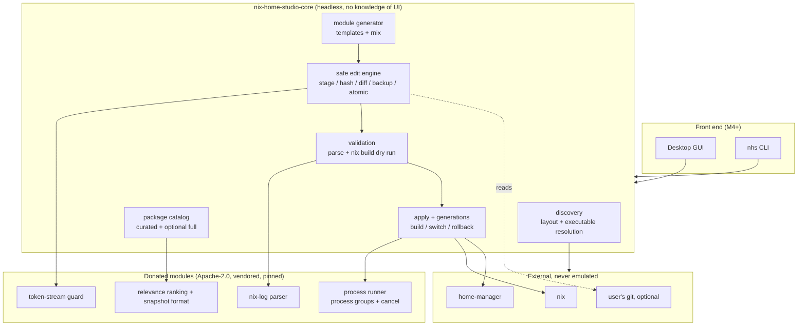
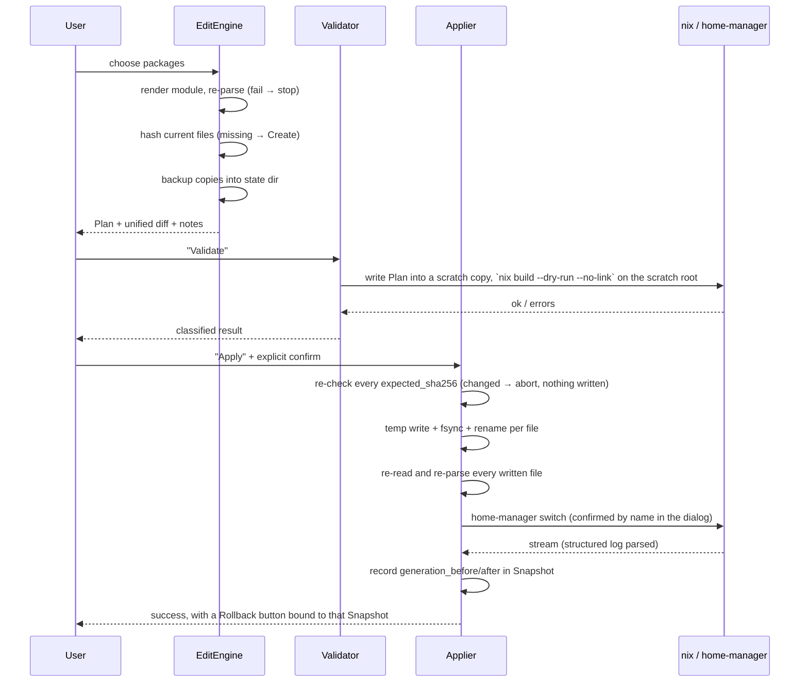

# Architecture

Status: proposal, pending user approval. Derived from `docs/upstream-audit.md` (phase 0). No implementation has begun.

## 1. Design drivers (from the audit)

1. **Safety before features.** Neither upstream has a correct safe-write loop (audit §2.4). The write pipeline is the product's core value, not a detail.
2. **Layout discovery is first-class.** The audit host has no `/etc/nixos`, no `~/.config/home-manager`, and no `home-manager` executable — only a HM generation profile (audit §4.2). Hardcoded paths are the top functional risk (R3).
3. **Touch user files as little as possible.** One generated sidecar module + one inserted import line is the entire footprint on a user-owned file.
4. **Licensing constrains reuse.** Donate from NixBox (Apache-2.0); re-implement, not copy, nix-home-manager-gui (no license).
5. **No surprises.** `build` and `apply` are separate verbs; nothing runs without an explicit confirmation that names the exact command.

## 2. Recommended stack

| Layer | Choice | Rationale |
| --- | --- | --- |
| Language | **Rust** (edition 2021; move to 2024 once the toolchain is pinned) | Donor code is Rust; `rnix` is the best available Nix parser; single static binary |
| Nix parsing | **`rnix` 0.14 + `rowan`** | Proven in both upstreams for AST splicing; audit §2.3 |
| Diff | **`similar` 2.x** | Unified diff with hunks; already the de-facto choice in nix-home-manager-gui |
| Process control | `tokio::process` + `libc` (process groups, signals) | Same approach as NixBox `build.rs`, verified by its tests |
| Serialization | `serde` / `serde_json` + `toml` | State, snapshots, curated catalog |
| Hashing | `sha2` (SHA-256 of file bytes) | Content-hash guard for concurrent-edit detection |
| CLI | `clap` derive | Needed for testing and for power users |
| **Gui** | **`iced` or `slint` (decided at M4, not now)** | See §2.1 — deliberately deferred |
| Packaging | Nix flake first; AppImage second | Nix-native delivery; avoids forcing WebKitGTK on Nix users |

### 2.1 Why the GUI toolkit is a milestone-4 decision

The audit shows that a Tauri front end brings `libwebkit2gtk-4.1`, `libappindicator`, `libxdo` runtime deps onto machines that may not have them, plus a disabled-by-default CSP risk (R11). A native Rust toolkit (`iced`/`slint`) yields a single binary that a Nix flake can package trivially. The headless core is designed so the toolkit choice cannot affect correctness — **every milestone through M4 is delivered as a CLI**. The toolkit is picked when the core is proven, not before.

## 3. Component boundaries



Hard rule: **`core` never prints, never reads `stdin`, never opens a window.** It reports through typed events/`Result`, exactly as NixBox's `nixbox-core` does (audit §1.1, `docs/ARCHITECTURE.md:27-54`). This is what makes the safety-critical logic testable without a display.

### 3.1 `discovery` — the subsystem the upstreams lacked

> Implements audit finding §4.2 / risk R3.

```rust
pub enum Layout {
    /// Flake with homeConfigurations.<user>
    FlakeHome { root: PathBuf, attr: String },
    /// Flake where HM is a NixOS module
    FlakeNixos { root: PathBuf, host: String, user: String },
    /// Classic: home.nix plus optional home-manager channel
    ClassicHome { main_file: PathBuf },
    /// No configuration found; HM exists only as a profile element
    ProfileOnly { profile_dir: PathBuf },
    Unknown { reason: String },
}

pub struct Toolchain {
    pub nix: PathBuf,
    pub home_manager: Option<HmInvocation>,
    pub nixos_rebuild: Option<PathBuf>, // detected for display only; never executed (D2)
}

/// How `home-manager` will be invoked. Ordered by reliability, per D5 detection.
pub enum HmInvocation {
    /// `home-manager` found on PATH
    Binary(PathBuf),
    /// Found by scanning the store for `*-home-manager-*/bin/home-manager`.
    /// **The audit host's real case** — the generation itself has no such binary.
    /// `candidates` is every match, best first, so the choice is auditable.
    FromStore {
        binary: PathBuf,
        version: String,
        candidates: Vec<PathBuf>,
    },
    /// Installed as a `nix profile` element; invoke through it
    ProfileElement { profile_dir: PathBuf, binary: PathBuf },
    /// Not found anywhere; fall back to nix run (slower, needs network)
    NixRun { flake_ref: String },
    /// Genuinely absent
    Absent,
}

pub fn detect(start: &Path) -> Discovery;         // pure over a filesystem trait, unit-testable
// Order is fixed: PATH, profile element, generation+store, nix run, absent.
pub fn resolve_toolchain(fs: &dyn FsView, env: &EnvView) -> Toolchain;
```

Rules:

- Follow a predefined search order and **report what was found and why**, not just "no config".
- Resolve `home-manager` in this order (D5): PATH → `nix profile` element → **scan the store for `*-home-manager-*/bin/home-manager`** → `nix run` fallback → `Absent`. The order is normative: `STRATEGY_ORDER` in `toolchain.rs` and `toolchain_attempts_follow_the_documented_order` both lock it, so implementation and this document cannot drift.
- **Store candidate selection is deterministic, not hash-ordered.** When several Home Manager builds exist, the highest parsed version wins (`0-unstable-2026-09-01` > `0-unstable-2026-08-06`, `26.11` > `25.05`); equal versions break ties by ascending store path. All candidates are reported in `HmInvocation::FromStore.candidates` and in the `attempts` text, so the choice is auditable. Ordering by hash prefix — the obvious `sort()` + `pop()` — picks an arbitrary *version* and is forbidden.
- **A Home Manager generation does not contain a `home-manager` binary.** The generation directory holds `activate`, `bin/home-manager-generation` (a symlink to `activate`), `home-path` (→ `…-home-manager-path`, containing only the package environment such as `hello`, `jq`, `rg`, `man`), `home-files`, `hm-version`, `gen-version`. Resolving `home-manager` from the generation's `bin/` or `home-path/bin` **fails**. The binary lives in a separate `*-home-manager-*` derivation in the store.
- The generation is still useful for *generation listing and rollback metadata* (`hm-version`, `gen-version`, `activate`), which is why `Layout::ProfileOnly` records it — but not for locating the tool.
- "Not found" is only reported after **all** strategies fail; the reason string must name every strategy tried.
- **Two layout classes must be tested separately**: the *real* layout (generation without the command, command in the store) and the *alternative* layout (generation carrying `bin/home-manager`). Tests are named `real_layout_*` and `alternative_layout_*` for exactly this reason. A pass in the alternative layout must never be cited as evidence for the real one.
- `discovery` must be pure over an injectable filesystem/env, so the four layouts can be tested from fixtures with no Nix installed. **No `std::env::set_var` in tests** (audit R13).
- Never mutate anything during discovery.
- Per D2, `nixos-rebuild` is resolved for *display* only. There is no code path that executes it, and no `sudo` helper exists in the codebase.

## 4. Configuration ownership and data model

### 4.1 Ownership: who may write what

| Path | Owner | App may |
| --- | --- | --- |
| `~/.config/nix-home-studio/modules/nhs-packages.nix` (or layout-appropriate root) | **App** | Create, rewrite wholesale (with token-stream guard) |
| user's `home.nix` / `flake.nix` | **User** | Insert **one** import line, with diff + backup + hash guard. Never rewrite (D3) |
| `~/.local/state/nix-home-studio/` (state, backups, snapshots) | App | Free |
| Nix store / profiles | Nix | Only via explicit `build`/`switch`/`rollback` — **never** `nixos-rebuild`, never `sudo` (D2) |

### 4.1.1 Refusal policy (D3, mandatory)

The app **refuses to write** and explains why when any of these hold. Refusal is a first-class, tested outcome — not an error path.

| Condition | Message requirement |
| --- | --- |
| Main file does not exist | name the expected path and how to create a config |
| `imports` cannot be located unambiguously (computed, string-built, or absent with no safe insertion point) | name the file and what construct blocked it |
| More than one plausible insertion point | list the candidates |
| File changed since the plan (hash mismatch) | which file, and that nothing was written |
| Generated file's program was hand-modified | which marker block |
| `rnix` reports the target as `Opaque`/`Partial` | the offending line range |
| Option is system-only but layout is user-profile | which option and why (D2) |

No partial writes on refusal: the whole `Plan` is abandoned.

The generated module is the only file we regenerate. This is NixBox's shape (audit §2.2) with its unsafe parts replaced.

### 4.2 The generated module

```nix
# Managed by nix-home-studio. Manual edits inside the markers are overwritten.
# Everything outside the markers is preserved.
{ pkgs, ... }:
{
  # nhs:managed:start
  home.packages = [
    pkgs.firefox
    pkgs.ripgrep
  ];
  # nhs:managed:end

  # nhs:settings:start
  programs.git.enable = true;
  # nhs:settings:end
}
```

- Marker blocks are the only regions parsed and rewritten.
- **Rewrite guard — approved deviation (2026-10-26):** before rewriting, the block's content must parse into exactly the shape the generator emits — one binding, `home.packages = [ pkgs.<attr> … ];`, every element a plain `pkgs.` select. The check is on **every direct entry** of the block, not on the entries that happen to be bindings: `inherit (pkgs) hello;` is a legal sibling of a binding and is refused by name and line rather than dropped. Anything else (an extra binding, a string element, `lib.optional …`, an expression carrying a comment) is likewise refused with its location and the file is left untouched. This replaces the originally planned token-stream `signature()` comparison: for the grammar this application emits it is strictly stricter (a signature normalises trivia and would admit token-identical but differently shaped content), and it can name what is wrong instead of reporting a hash mismatch.
- **Ownership inside the markers.** Content the generator could itself have produced is *replaced*, not merged: without stored state a stale selection and a hand-added line are indistinguishable, so each block is regenerated from the selection. That is not a silent deletion — the removal is in the diff the user reviews before applying. What the guard refuses is content it could not re-emit (a computed element, a non-scalar value, an interior comment), because overwriting *that* destroys information no diff can restore.
- Hard-coded tabs/spaces are forbidden: indentation is inherited from the file on first write and remembered afterwards.

### 4.3 Core data types

```rust
pub struct Plan {                 // fully serialisable; this is the diff preview object
    pub id: PlanId,
    pub layout: Layout,
    pub changes: Vec<FileChange>,
    pub notes: Vec<Note>,         // e.g. "NixOS-only option", "requires unfree"
}

pub struct FileChange {
    pub path: PathBuf,
    pub kind: ChangeKind,         // Create | Replace (a one-line import insertion is a Replace)
    pub expected_sha256: Option<Sha256>,  // None only when creating
    pub old_text: String,
    pub new_text: String,
    pub unified_diff: String,     // rendered by `similar`
}

pub struct Snapshot {             // authoritative record of an apply attempt
    pub plan: Plan,
    pub backups: Vec<BackupEntry>,   // path + stored copy + sha256
    pub generation_before: Option<GenId>,
    pub generation_after: Option<GenId>,
    pub outcome: Outcome,            // Pending | Built | Applied | Failed | RolledBack
}
```

`Plan` is produced without touching disk, is what the user reviews, and is the same object the applier consumes. There is no second code path between preview and write — that is a structural guarantee, not a convention.

## 5. Package catalog pipeline

Two tiers, because a full nixpkgs catalog costs minutes and 256 MiB JSON (audit §2.1, R5).

```
curated catalog (shipped, TOML)         full catalog (optional)
  name, attr, description,              nix search --json <nixpkgs-ref> ^
  category, platforms, license,            │
  requires (unfree/nixos-only)             ├─ snapshot JSON (versioned)
        │                                  ├─ atomic rename write
        └──────────┬───────────────────────┘
                   ▼
          in-memory index (lowered, pre-split)
                   ▼
     search(query, filters) → ranked hits
```

- **Curated tier** ships with the app (a few hundred beginners' packages), needs no Nix call, works offline, and carries the metadata NixBox lacks (license, platform, unfree flag — audit §2.1 "no filters at all").
- **Full tier** is opt-in, cancellable, with progress; snapshot cache is versioned and invalidated by hashing the resolved nixpkgs ref.
- **Revision source, in priority order:** explicit flake ref from the detected layout → `flake.lock` **following `follows` indirection** (NixBox bails on `follows`, `search.rs:290-294`) → registry default. This precedence must be a test.
- Search ranking may be donated (NixBox `relevance_fields`); filters and pagination are new.

### 5.1 Platform matching (normative)

An entry's `platforms` list contains **tags**, each either a generic family
(`linux`, `darwin`, `unix`) or a concrete Nix system (`x86_64-linux`,
`aarch64-linux`, `x86_64-darwin`, `aarch64-darwin`). The host is reduced to the
same vocabulary: family from the OS, architecture from the CPU, and the concrete
system from both (`x86_64-linux` on this machine).

Matching, in order:

1. **Empty list ⇒ support unknown.** The entry is **shown**, tagged
   `platform: unknown`. Unknown is never treated as unsupported — hiding a
   package because the catalogue does not know where it runs is the failure mode
   that makes a search box useless.
2. A tag equal to the host system (`x86_64-linux`) matches.
3. A generic tag matching the host family (`linux`, `unix` on Linux) matches.
4. A tag naming only other systems/families (`aarch64-darwin` on `x86_64-linux`)
   does not match.
5. An entry is excluded **only** when its list is non-empty and no tag matches by
   rule 2, 3 or 6. An unrecognised tag is a non-match, never an error.
6. `unix` is a family alias matching every Linux and Darwin system.
7. `--platform <tag>` replaces the host for that run: the entry must match the
   given tag by rules 2, 3 or 6.

### 5.2 Snapshot reuse (normative)

A cached full-tier snapshot is reused only when **all** of these hold; otherwise
it is rebuilt:

1. `format_version` equals the constant this build knows;
2. `revision_hash` equals `sha256(resolved_ref ‖ "\0" ‖ format_version)` computed
   from the source resolved **now** — so a changed `flake.lock`, a changed
   `--flake-ref` or a bumped format invalidates the cache;
3. the file parses and carries `complete: true`;
4. the entry digest recomputes to `entries_sha256`, and `entries_count` equals the
   length of the array (cheap corruption check on top of the digest).

Writing is all-or-nothing: the snapshot is assembled, digested, and only then
written with an atomic rename. A run that hit the byte cap, was cancelled, exited
non-zero or failed to parse writes **no** snapshot and removes its temporary file
— an incomplete run must never leave something a later run could mistake for a
complete catalogue.


## 6. Module generation pipeline

Driven by *intent*, not by text templates alone:

```
Selection (package attrs / option values)
   │  validate against catalog metadata + layout
   ▼
ModuleSpec { packages, settings, layout }
   │  render with a real pretty-printer (rnix-built or template + re-parse)
   ▼
Module text ── rnix parse ── must produce zero errors
   ▼
EditEngine.stage(path, new_text)      → FileChange (hash, diff)
   ▼
Plan
```

- Every render is **re-parsed**; a template that cannot be parsed is a bug, caught by fixture tests.
- Options that are NixOS-only are marked in `Plan.notes` and refused under `Layout::FlakeHome` / `ClassicHome` (audit: portability requirement in `AGENTS.md`). The refusal is a precondition of `render`/`rewrite` (`Target::Home`), not a caller convention, so an unsupported option cannot reach a file. The flag is returned to the caller rather than written into the module: v1 writes no NixOS module (D2), and an interior comment would be refused by the rewrite guard — see the deviation note in `implementation-plan.md` §M3.
- Import insertion into the user's main file is its own `FileChange{kind: InsertLine}` and uses `rnix` to find the real `imports` attribute inside the module attrset — replacing NixBox's regex/lexer approach (audit §2.3).

## 7. Safe edit → validate → apply → rollback flow

This is the heart of the product. Every step is a distinct, testable function.



### 7.1 Normative rules

1. **No write without a Plan the user has seen.** The applier accepts only a `Plan`, never a path+text pair — and it re-derives every hash, line count and diff from `old_text`/`new_text` before writing, so a plan mutated after review is rejected rather than applied.
2. **No write without a backup.** Backups live outside the config tree (`~/.local/state/nix-home-studio/backups/`), are content-addressed, and are never overwritten. The backup must hash to the *expected* pre-plan hash, so a backup newer than what was reviewed is a conflict.
3. **No write if the file changed since the plan.** SHA-256 is compared twice: for the whole plan before any write (fail fast), and again for each file immediately before its own write. A mismatch aborts and restores only what was already written; untouched files keep whatever the user did to them.
4. **Atomic per file, and "written" is decided at the rename:** temp file in the same directory → `rename`, permission bits carried over. The rename is the commit point; a directory flush afterwards is best effort, because reporting a flush failure as a write failure would make the engine skip restoring a file that really did change. A `Create` uses `O_EXCL` so it cannot clobber a file created in the gap, and a `Create` that fails after the file exists is cleaned up immediately — a partially written new file must not be left behind. If any file fails, exactly the files whose bytes may exist are restored in reverse order, and **every** restore is content-guarded, including the deletion of a file this plan created: the rollback deletes a created file only while it still holds bytes this write can be attributed (a prefix of the planned text); a path that somebody else claimed in the meantime is left untouched and reported as a residue instead of being deleted. "It did not exist before my plan" is never sufficient grounds to delete a path. A guard is a positive check, so the observed state of a target has three outcomes, not two: absent, present-with-these-bytes, **and unreadable**. An unreadable target satisfies no guard at all — "I could not read it" is not evidence of absence, and a failed read must never authorise a delete or an overwrite.
5. **No apply without a successful validate**, and validate must build a **scratch copy**, never the live tree. (NixBox validates nothing before writing; nix-home-manager-gui validates nothing at all — audit §2.4/§2.6.)
6. **`build` and `switch` are different buttons with different words.** `switch` requires a confirmation that displays the literal command line.
7. **Nothing auto-applies.** Editing state and disk state are separate until "Apply".
8. **Rollback runs HM's own command** (`home-manager switch --rollback` / `--switch-generation N`), not `<store>/activate`, so HM's profile bookkeeping stays consistent (audit §2.5, R8).
9. **Refuse rather than guess** on any construct `rnix` renders `Opaque`/`Partial`.
10. **Only paths inside the configuration tree may be requested.** A symlink *inside* the tree may point outside it (the dotfiles layout); the resolved target is recorded, so revert can prove the way in was a link the user owns. A request naming a path outside the tree is refused outright.
11. **A revert is a write.** It takes the same lock, verifies every backup hash before restoring any of them, and refuses if the file no longer holds what the snapshot wrote (or, for crash recovery, still holds what it held before).
12. **A failed commit must never be reported as "nothing written" if bytes landed.** If the snapshot update fails after the writes, the commit returns success with a warning: the change happened, only the record is incomplete.
13. **A guard is check-then-act, so the action must be as close to the check as the API allows.** No probe, lookup or logging between the verifying read and the destructive call, and an unverifiable target satisfies no guard. This does **not** make the pair atomic — §7.1.1 states the exact window, what is guaranteed instead, and the threat model it is valid under.

### 7.1.1 Concurrency boundary (what check-then-act cannot promise)

Every guard in this engine is a check followed by an action: hash check → `rename`, observed state → `unlink`. POSIX offers no atomic compare-and-act on a path (`renameat2(RENAME_NOREPLACE)` would cover creation only, and `std` does not expose it), so the two are separate syscalls and a writer that lands between them is undetectable.

| Action | Window | If a concurrent writer wins the window |
| --- | --- | --- |
| Write / replace | last hash check → `rename` | their bytes are replaced by the plan's; the pre-write backup and the `Pending` snapshot make it recoverable |
| Delete (rollback or revert) | verifying read → `unlink` | their file is deleted; the app cannot recover it |

What the engine guarantees instead:

1. The destructive call is the **next** filesystem operation after the check — no re-probe, no lookup, no bookkeeping in between. Locked by `a_guarded_delete_immediately_follows_its_verifying_read`.
2. Content is verified, never assumed: `Absent`, `Present(hash)` and `Unreadable` are distinct, and an unreadable target satisfies no guard.
3. Nothing is written before every replaced file is backed up outside the tree and a `Pending` snapshot exists, so a clobbered write is recoverable.
4. Anything the engine cannot claim is reported (`residue`, `StaleRevert`, per-file refusal), never silently removed.

What is explicitly **not** guaranteed: correctness against a writer that modifies the *same* path in the microseconds between the final check and the syscall. The model is "detect concurrent modification as late as possible and keep a recovery path", not mutual exclusion. The threat model is a person editing their configuration in another editor — a window of seconds to minutes, which is detected — not an adversary racing the app syscall by syscall, which no path-based API in this stack can exclude.

If that assumption ever changes, the options are: keep the descriptor from the write and verify `(dev, ino)` plus size/mtime immediately before `unlink`, or `rename` the target into a private name, re-verify, and delete or put it back. Both narrow the window or make the outcome recoverable; neither makes it atomic, and the recursion (restoring the quarantined file races in the same way) does not disappear. That is why it is a v1 non-goal rather than an unstated gap.

### 7.2 Generation model

```rust
pub enum GenerationSource { HomeManager { attr: String }, NixosProfile, AppProfile }
pub struct Generation { pub id: u32, pub date: String, pub store_path: PathBuf, pub current: bool }

pub trait Generations {
    fn list(&self) -> Result<Vec<Generation>>;
    fn rollback_to(&self, id: u32) -> Result<()>;   // HM's own command under the hood
}
```

- Discovery of `list()`: parse profile symlinks under `~/.local/state/nix/profiles/` (works on the audit host, where a `home-manager` + `home-manager-{1,2,3}-link` set exists) and, when available, `home-manager generations` output. Each generation is cross-checked against its `nix-store -q` path.
- Two independent rollback paths are exposed and **labelled distinctly** in the UI: (a) Home Manager generation rollback, (b) restore files from an app `Snapshot`. Conflating these is a beginner trap.
- Git history is *not* treated as rollback: it is shown as an optional audit trail of what the app changed (NixBox's journal idea, minus its push/create-remote features).

## 8. Failure recovery and portability boundaries

### 8.1 Recovery matrix

| Failure | Recovery (implemented in M2 unless marked) |
| --- | --- |
| User edits file between plan and apply | Hash mismatch → nothing written, whole plan invalidated |
| User edits file *during* the apply, after its hash check | The per-file re-check catches it before that file is written; already-written files are restored and the untouched ones keep the user's edit |
| Crash after file 1 of 3 written | `Snapshot` with `outcome: Pending` marks the attempt. Revert accepts a file that still holds either the pre-plan or the post-plan content, so a half-applied attempt is recoverable |
| Crash mid-rename | Only a temp file is left; the target is either old or new, never truncated |
| Write succeeds, `nix build` fails (M4) | Files stay (user can inspect), snapshot records the failure, "Revert this snapshot" offered |
| `switch` fails midway (M7) | Generation unchanged → offer the `generation_before` rollback |
| `switch` succeeds, user dislikes result (M7) | "Roll back to generation N" from the snapshot |
| Backups missing/corrupt | Every backup hash is verified before any restore; refuse and name the file |
| A file changed after our write, before a revert | Refused as `StaleRevert`; the later edit wins |
| Snapshot update fails after the bytes landed | Commit returns success with `Applied.warning`; the record stays `Pending` |
| Another instance running | `create_new` lock in the state dir held for the whole commit **and** revert; a token proves ownership on release; a stale lock is reported with its holder, never deleted |

State is written **before** the risky step and updated after it, so the inverse of NixBox's ordering bug (journal written after files, `engine.rs:288-297`) cannot occur. `Snapshot` carries a `format_version` from day one (NixBox's `Op` enum has none — audit §2.4 recovery note).

### 8.2 Portability boundaries

| Supported (v1) | Explicitly out of scope (v1) |
| --- | --- |
| HM flake, HM classic, HM-in-NixOS **detected read-only only** (D2) | `nixos-rebuild switch`, any `sudo`, any system mutation (D2) |
| Nix on a non-NixOS distro (the audit host) | `nix-darwin`, WSL, multi-user remote builders |
| HM installed as binary **or** as a `nix profile` element **or** inside a generation **or** absent (via `nix run`) — D5 | Nix 2.18-era classic channels as the *primary* source of packages |
| Git as an optional audit trail | Git/JJ push, remote creation (dropped from NixBox's donor set) |

### 8.2.1 Compatibility claim rules (D5)

"Supported" is a **per-fixture-class** statement, never a general one.

| Fixture class | Status after M1 | Where tested |
| --- | --- | --- |
| `ProfileOnly` (this CachyOS host) | **Primary acceptance target** | real path resolution + fake commands |
| `FlakeHome` | required fixture, added M1–M3 | fixture tree + fake commands |
| `ClassicHome` | in compatibility test plan | fixture tree |
| `FlakeNixos` (read-only detection) | in compatibility test plan | fixture tree |

Until every row has a passing fixture test, documentation must say "verified on X, not verified on Y" rather than "supports Home Manager".

System-specific options are **refused** for a Home Manager target, and the refusal names every offending option (§6). The flag is returned to the caller (`check_target` → `Plan.notes`) and shown in the diff view; it is deliberately **not** written into the generated module — v1 writes no NixOS module (D2), and an interior comment would be refused by the rewrite guard (§4.2). See the pending deviation note in `implementation-plan.md` §M3.

## 9. What we donate, and under what terms

| Donor | Module | Terms |
| --- | --- | --- |
| NixBox `nix_log.rs` | structured log parsing | Apache-2.0; NOTICE + commit `7bab22d` recorded |
| NixBox `build.rs` runner | process groups, cancellation | Apache-2.0 |
| NixBox `search.rs` (catalog/ranking only) | snapshot format, relevance | Apache-2.0; filters/hash-invalidation added |
| NixBox `migration.rs` `signature()` / `atomic_write` | token guard, atomic write | Apache-2.0 |
| NixBox `wiring.rs` `attr_name` | Nix identifier quoting | Apache-2.0 |
| nix-home-manager-gui `nix_edit.rs`, `workspace.rs`, `commands.rs` | AST-splice pattern, staged-copy guard, server-side id re-resolution | **No license — re-implement from the described pattern. No code copied.** |

Telemetry code (`nixbox-config/src/telemetry*`) is **excluded**, not disabled.

## 10. Decisions approved by the user (2026-10-25)

These are no longer open questions; they are binding project rules.

| # | Decision | Architectural consequence |
| --- | --- | --- |
| D1 | **License red line.** `nix-home-manager-gui` is design/behaviour reference only — no code copied. Prefer NixBox's self-contained Apache-2.0 modules, keeping licence, copyright notices and `NOTICE`. Anything with unclear licensing is excluded. | §9 is normative, not advisory. `LICENSE`, `NOTICE`, and `src/donated/<module>/PROVENANCE.md` (upstream repo + commit `7bab22d` + original path) are required files. Dependency allowlist gate G1 blocks the rest. |
| D2 | **v1 drops `nixos-rebuild`/sudo.** v1 targets Home Manager on a normal Linux distribution. NixOS gets read-only detection and display only: no rebuild, no system mutation, no sudo. System-level NixOS management is re-evaluated later. | `Apply` verbs are limited to `home-manager build` / `switch` (user profile). There is no `sudo` code path at all — not even disabled — so it cannot be re-enabled by accident. NixOS detection yields display-only state. |
| D3 | **Sidecar module + one import line.** Packages and module config go into a generated `.nix` file; at most one import line is added to the user's existing config. Never rewrite whole user files, never overwrite user settings. On ambiguous insertion points, unclear structure, or detected external modification: refuse and explain. Every write shows a diff, backs up, and hash-checks first. | §4.1 ownership table is normative. `ImportInjector` must fail closed. `Plan` is the only write input (G3/G5). |
| D4 | **Curated catalog first.** v1 ships a curated common-software catalog so search, descriptions and generation are reliable. Full nixpkgs search is an explicit opt-in, labelled with data source, refresh mechanism and possible staleness. Full search must never block core development. | §5 two-tier design is normative: curated tier is the default and offline; full tier is behind an explicit action. M5 splits into M5a (curated) / M5b (full). |
| D5 | **Primary acceptance environment: this CachyOS host's `ProfileOnly` state first**, plus a controlled temporary `HOME` and fake Nix/Home-Manager commands. Re-detect the machine rather than trusting the earlier audit. `ProfileOnly` must not be skipped just because it is the weakest shape — but it must not be used to claim compatibility with all Home Manager deployments. A Home-Manager-flake fixture with real config files must follow, and classic + NixOS-integration modes enter the compatibility test plan. **No test may modify real user config or run an actual switch.** | M1's fixtures are ordered by D5. The `ProfileOnly` fixture is a first-class target, not a fallback. "Supported" may only be claimed per fixture class, never generally. |

### 10.1 Re-detected environment (2026-10-25, after D5 instruction)

Re-verified rather than assumed; confirms audit §4.2 and adds one detail.

| Fact | Evidence |
| --- | --- |
| Nix 2.35.4 at `/usr/bin/nix`, flakes usable | `nix --version`; `nix eval --expr '1+1'` → `2` |
| `home-manager` **not on `PATH`** | `which home-manager` → not found |
| Home Manager binary **does exist in the store** | `/nix/store/86nwi02…-home-manager-0-unstable-2026-08-06/bin/home-manager` |
| HM profile exists, 3 generations | `~/.local/state/nix/profiles/home-manager` → `home-manager-3-link` → `…-home-manager-generation` |
| **HM generation contains no `home-manager` binary** | generation `bin/` holds only `home-manager-generation → ../activate`; `home-path` → `…-home-manager-path` whose `bin/` is `accessdb, apropos, catman, hello, jq, … rg …` |
| HM generation layout | `activate`, `bin/`, `home-path` → `…-home-manager-path`, `home-files`, `hm-version` (`26.11`), `gen-version` (`1`), `extra-dependencies`, `putter.json` |
| `~/.nix-profile` is a symlink to the `profile` generation; its `bin/` has no `nix` and no `home-manager` | `ls ~/.nix-profile/bin` → `hello, jq, rg, man…` only |
| No `/etc/nixos`, no `~/.config/home-manager`, no `~/.config/nixos`, no `flake.lock` | `ls` → all absent |
| No channels | `nix-channel --list` → empty |
| `XDG_CONFIG_HOME` / `XDG_STATE_HOME` / `XDG_DATA_HOME` unset | env inspection → defaults apply |
| CachyOS (Arch-based), not NixOS | `/etc/os-release` → `ID=cachyos` |
| Rust 1.98.0 via `cargo +stable`; no default toolchain | `rustup show` → no active toolchain |
| Orca runtime ready; `pi` 1.3.0, `claude` 2.1.232 available | `orca status`, `pi --version`, `claude --version` |

Verified twice independently (audit pass, then a re-detection pass per D5) with matching results.

